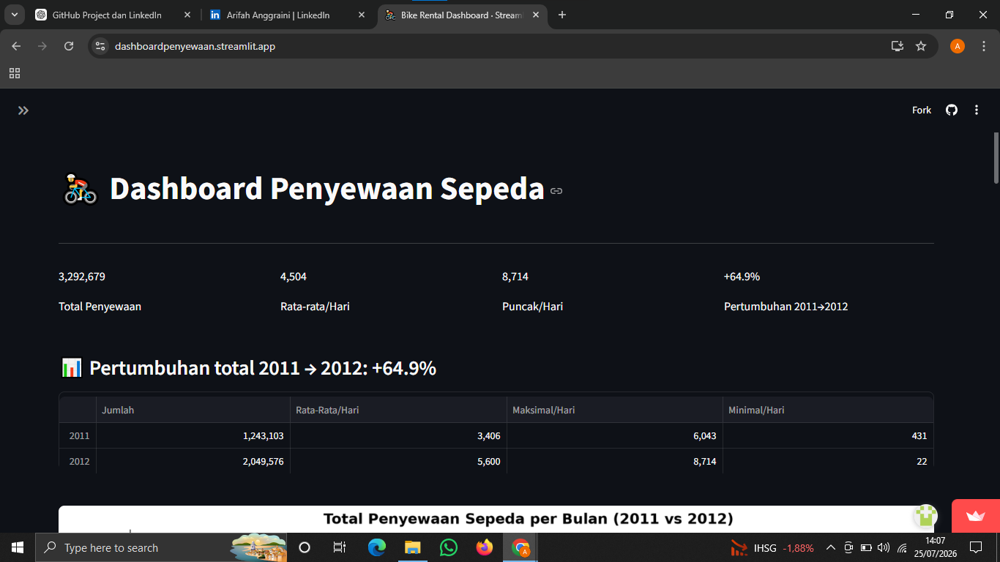

# 🚲 Bike Sharing Data Analysis Dashboard

This repository contains the final project for the **Belajar Analisis Data dengan Python** course. The project explores the Bike Sharing Dataset to uncover rental patterns through data analysis and interactive visualizations.

## 📌 Project Background

Bike-sharing services generate large amounts of data that can be analyzed to understand customer behavior and operational trends. This project aims to answer several business questions through Exploratory Data Analysis (EDA) and an interactive Streamlit dashboard.

---

## 🎯 Business Questions

- How did total bike rentals change from 2011 to 2012?
- How do season and weather conditions affect bike rental demand?
- At what hours does bike rental activity reach its highest and lowest levels?

---

## 📊 Dashboard

🌐 **Live Dashboard**

https://dashboardpenyewaan.streamlit.app

---

## 📂 Dataset

The analysis uses the **Bike Sharing Dataset**, which contains daily and hourly bike rental records along with weather and seasonal information.

Main variables include:

- Date
- Season
- Weather
- Temperature
- Humidity
- Wind Speed
- Casual Users
- Registered Users
- Total Rentals

---

## 🛠️ Technologies Used

- Python
- Pandas
- NumPy
- Matplotlib
- Seaborn
- Streamlit

---

## 📈 Analysis Workflow

- Data Gathering
- Data Assessment
- Data Cleaning
- Exploratory Data Analysis (EDA)
- Data Visualization
- Dashboard Development

---

## 💡 Key Findings

- Bike rentals increased by approximately **64.9%** from 2011 to 2012.
- The highest rental activity occurred during **Fall** under **Clear Weather** conditions.
- Rental demand peaked at **17:00**, while the lowest activity occurred during early morning hours.

---

## 🚀 Run Locally

Clone the repository

```bash
git clone https://github.com/Arifahanggraini05/AnalisisData.git
```

Install dependencies

```bash
pip install -r requirements.txt
```

Run the Streamlit dashboard

```bash
streamlit run dashboard/dashboard.py
```

---

## 📷 Dashboard Preview



---

## 👩‍💻 Author

**Arifah Anggraini**

Final Project — Belajar Analisis Data dengan Python
